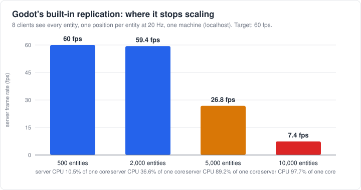
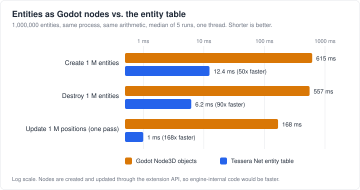
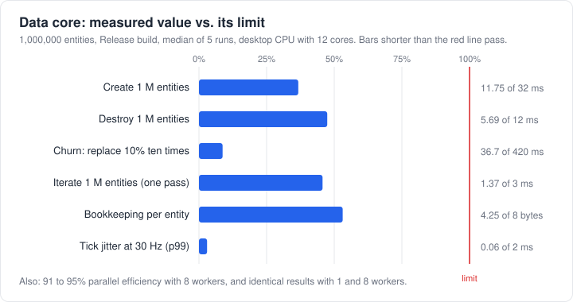
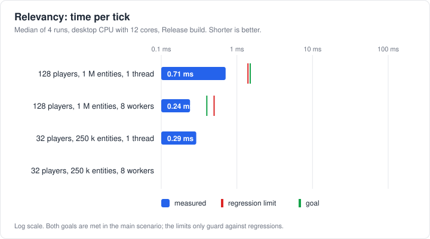
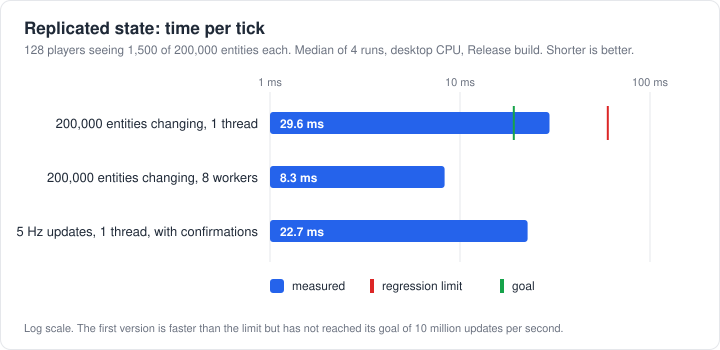
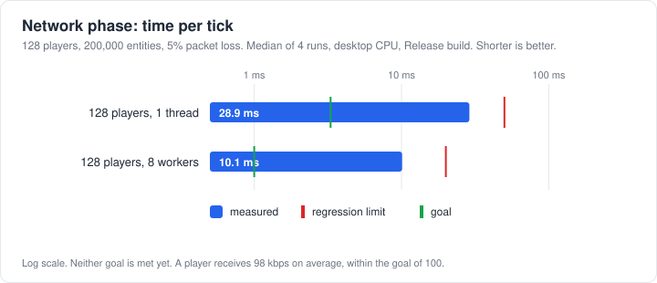

# Tessera Net

High-performance, dedicated-server networking for Godot 4, built for large open worlds.

Part of **Tessera**, a family of open-source tools for building large multiplayer games in Godot.

> **Status: pre-alpha.** The engine-independent data core (entities, fixed-step tick loop, spatial grid,
> job system), a relevancy engine (deciding what each player sees), replicated state (turning what
> changed into small buffers for each player) and a server and a client that exchange them over a simulated
> network are implemented and tested. A transport over real sockets, the Godot plugin and the dedicated server
> are not built yet, so nothing here is ready for production. Follow the [roadmap](docs/roadmap.md) for
> progress.

## Why this exists

Godot's built-in multiplayer is great for small games. It replicates every visible node to every client,
which stops scaling at a few thousand entities. In our baseline measurement a single server core handled
roughly 0.85 million entity updates per second at about 19 bytes each, and degraded sharply above
2,000 entities with 8 clients. Open-world survival games need far more than that.

This project builds the missing pieces so Godot developers can make those games:

- **Interest management**: each player only receives what is near them.
- **Dormancy**: entities that are not changing cost nothing.
- **Delta compression and quantization**: small packets, small bills.
- **Multi-threaded replication**: spreads the work across CPU cores.
- **A standalone dedicated server**: a lean binary that does not need the Godot engine.
- **Prediction and reconciliation** for smooth movement under lag.
- **Editor tools**: configure everything from the Godot editor, no networking PhD required.



Part of the problem is how entities are stored. A million entities kept as nodes are slow to create, update
and remove, while the entity table in this project does the same work on plain arrays:



Read the full [motivation](docs/motivation.md) and the [benchmarks](docs/benchmarks.md).

## Design goals

| Goal | Target |
|---|---|
| Replication throughput | at least 10 million entity updates per second per core |
| Network phase per tick, 128 clients | 3.3 ms or less on one thread |
| Position update size | 8 bytes or less |
| Idle (dormant) entity | zero CPU and zero bytes per tick |
| Registered entities | 1 million, cost proportional to changes |

These are targets, not results. Measured numbers are published as they exist, including the ones that miss
their target. For example, the relevancy engine takes about 1 ms per tick on one thread for 128 players among a
million entities, against a goal of 1.5 ms; a first version took 15 ms. Replicated state, on the other hand,
writes about 5.8 million updates per second on one thread against a goal of 10 million, and the whole network
phase takes about 66 ms per tick for 128 players in a large, busy world against a goal of 3.3 ms. See the
[benchmarks](docs/benchmarks.md#5-relevancy) and the [network section](docs/benchmarks.md#7-the-whole-network-path).

## What exists today

The **data core** (`core/`): entity storage in paged tables, 64-bit entity ids, a fixed-step tick loop with
five phases, a sparse 3D spatial grid, a thread-pool job system and deterministic command buffers. See the
[core reference](docs/reference/core.md) for how each part works and a runnable example.



The **relevancy engine** (`core/`): for every player, which entities do they need to know about? Each type of
entity gets a range (or is always visible, or visible only to its owner), groups make exceptions, and every
visible entity gets a short id on that player's connection. It runs on many threads and gives the same result
with one worker or many. See the [relevancy reference](docs/reference/relevancy.md).



Both relevancy goals are met in the main scenario (128 players, one million entities, 700 of them moving per
tick): about 1 ms per tick on one thread and 0.3 ms with eight workers. The engine does a full look around a
player only when they have moved a few metres; see [record 0008](docs/adr/0008-incremental-relevancy.md).

**Replicated state** (`core/`): for each player, only what changed in the entities they can see, as a few
bytes. Properties are described once (a position to the centimetre, an angle, a health), every change is
written against the last state the player confirmed, so lost, repeated and late packets do no harm, and an
entity that has not changed costs nothing. A position update takes about 4.4 bytes. See the
[replicated state reference](docs/reference/replicated-state.md).



The goals for size and memory are met; the goal for speed is not yet: about 5.8 million updates per second on
one thread (the goal is 10 million) and about 44% efficiency with eight workers (the goal is 70%). The
numbers and what is left to improve are in [record 0009](docs/adr/0009-replicated-state.md).

**Networking** (`core/`): a transport interface that moves whole messages on a reliable and an unreliable
channel, a simulated network in memory that loses, repeats and delays them, five messages, a
`ReplicationServer` that runs the whole network phase of a tick, and a `ClientReplica` that applies what arrives
and confirms it. Tests run the real server and real players over a bad network and check that every player ends
up with exactly what the server has. See the [networking reference](docs/reference/networking.md).



Players converge, but the goals for the whole phase are not met: with 128 players in a world of 200,000
entities, a sixth of them changing in every tick and 5% of packets lost, the phase takes about 66 ms per tick on
one thread (the goal is 3.3 ms) and the server sends about 960 kbps to each player (the goal is 100). Most of the bytes are
repeats of entities that have not been confirmed yet. The numbers are in
[record 0010](docs/adr/0010-transport-and-protocol.md) and on the [benchmarks page](docs/benchmarks.md#7-the-whole-network-path).

All numbers, conditions and caveats are in [docs/benchmarks.md](docs/benchmarks.md).

## Quick start

Not available yet. When the first release is ready you will download a ZIP, copy it into your project and
enable the plugin. See [Getting started](docs/getting-started.md) for the current status.

## Building from source

You only need this if you want to contribute or try unreleased code.

Windows (Visual Studio 2022 with the C++ workload, CMake 3.21+):

```powershell
./tools/build.ps1
```

Linux (CMake 3.21+, Ninja, GCC 11+ or Clang 14+):

```bash
./tools/build.sh
```

To also build and run the acceptance benchmark (Release builds only):

```powershell
cmake --preset windows-msvc -DTESSERA_BUILD_BENCH=ON
cmake --build --preset windows-msvc-release --target tessera_net_bench
./build/windows-msvc/bench/Release/tessera_net_bench.exe
```

## Repository layout

| Folder | Contents |
|---|---|
| `core/` | The engine-independent C++ library (the heart of the project) |
| `extension/` | The Godot GDExtension that exposes the core to the editor and GDScript |
| `server/` | The standalone dedicated server program |
| `addons/` | The Godot plugin shipped to users |
| `examples/` | Small projects that work as soon as you open them |
| `tests/` | Automated tests |
| `bench/` | Benchmarks: the data core, relevancy, replicated state, the network path and the comparisons shown in the docs |
| `docs/` | Documentation, architecture and decision records |
| `tools/` | Build and packaging scripts |

## Documentation

- [Documentation home](docs/index.md)
- [Getting started](docs/getting-started.md)
- [Concepts explained simply](docs/concepts.md)
- [Core library reference](docs/reference/core.md)
- [Relevancy reference](docs/reference/relevancy.md)
- [Replicated state reference](docs/reference/replicated-state.md)
- [Networking reference](docs/reference/networking.md)
- [Benchmarks](docs/benchmarks.md)
- [Architecture](docs/architecture.md)
- [Roadmap](docs/roadmap.md)
- [Architecture decision records](docs/adr/README.md)

## Contributing

Contributions are welcome. Please read [CONTRIBUTING.md](CONTRIBUTING.md) first.

## License

- **Code:** [Apache License 2.0](LICENSE). Keep the copyright and the [NOTICE](NOTICE) when you redistribute.
- **Documentation:** [CC BY 4.0](docs/LICENSE.md).
