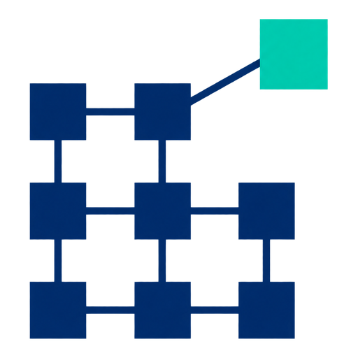

<p align="center">
  <picture>
    <source media="(prefers-color-scheme: dark)" srcset="docs/images/tessera-net-logo-dark.png">
    
  </picture>
</p>

# Tessera Net

Dedicated-server networking for Godot 4, made for large open worlds.

Godot's built-in multiplayer sends every visible node to every client, and that stops scaling at a few thousand entities. Tessera Net is my attempt at the missing piece: a server that doesn't need the engine, sends each player only what is near them, and keeps the packets small, plus a Godot extension for the client side. It is part of **Tessera**, a family of open-source tools for large multiplayer games in Godot.

> **It is alpha, and I'd rather be clear about where it stands.**
>
> What works today: a C++ core, the server as a library with a small example program, replication over real sockets (ENet), and a first Godot client (a GDExtension plus a demo project). The client has been loaded into Godot 4.7.2 and run end to end on Windows and, in a container, on Linux. CI builds and tests all of it on Ubuntu and Windows.
>
> What doesn't exist yet: the editor plugin, prediction and reconciliation, smoothing on the client, and anything you should run in production. Follow the [roadmap](docs/roadmap.md) for progress.

**Want to see it move?** Build the extension and run the demo: [`examples/godot-client-demo`](examples/godot-client-demo/README.md).

**The numbers, with their caveats.** On one machine, over localhost, with 8 bot clients and every entity moving at 20 Hz, the server used 4.9 to 7.0 times less CPU than Godot's built-in replication, and sent 2.6 to 5.0 times fewer bytes to each client (500 to 10,000 entities). Part of that gap comes from design choices, like positions quantized to 1 cm, and not only from efficiency. The [comparison](docs/benchmarks.md#8-tessera-net-and-godots-built-in-replication-same-scenario) has the table and the limits.

## Why this exists

Godot's built-in multiplayer is great for small games. It replicates every visible node to every client,
which stops scaling at a few thousand entities. In our baseline measurement a single server core handled
roughly 0.85 million entity updates per second at about 19 bytes each, and degraded sharply above
2,000 entities with 8 clients. Open-world survival games need far more than that.

The same scenario, run against a Tessera Net server, is compared at the top of this page and in detail in the [comparison](docs/benchmarks.md#8-tessera-net-and-godots-built-in-replication-same-scenario).

This project builds the missing pieces so Godot developers can make those games:

- **Interest management**: each player only receives what is near them.
- **Dormancy**: entities that are not changing cost nothing.
- **Delta compression and quantization**: small packets, small bills.
- **Multi-threaded replication**: spreads the work across CPU cores.
- **A standalone dedicated server**: a lean program that does not need the Godot engine (a library plus an example, see [`server/`](server/README.md)).
- **A Godot client**: a GDExtension to connect a Godot project to a server, read its entities and send the player's input (a first version, see [`extension/`](extension/README.md)).
- **Prediction and reconciliation** for smooth movement under lag.
- **Editor tools**: configure everything from the Godot editor, no networking PhD required.


Part of the problem is how entities are stored. A million entities kept as nodes are slow to create, update
and remove, while the entity table in this project does the same work on plain arrays:


Read the full [motivation](docs/motivation.md) and the [benchmarks](docs/benchmarks.md).

## Design goals

| Goal | Target |
|---|---|
| Replication throughput | at least 10 million entity updates per second per core |
| Network phase per tick, 128 clients | 3.3 ms on one thread and 1 ms with eight workers, at 1,000 moving entities per tick (table below) |
| Position update size | 8 bytes or less |
| Idle (dormant) entity | zero CPU and zero bytes per tick |
| Registered entities | 1 million, cost proportional to changes |

These are targets, not results, and the one for the network phase depends on the load (see below). Measured numbers are published as they exist, including the ones that miss
their target. For example, the relevancy engine takes about 0.7 ms per tick on one thread for 128 players among a
million entities, against a goal of 1.5 ms; a first version took 15 ms. Replicated state, on the other hand,
writes about 5.8 million updates per second on one thread against a goal of 10 million, and the whole network
phase takes 32 to 38 ms per tick on one thread (9 to 11 ms with eight workers, depending on how busy the machine
was) for 128 players when a sixth of 200,000 entities changes in every tick, against 3.3 ms (1 ms). That is the heaviest load we built, and the time of the phase
depends on how many entities move, so the goal for it is written by entities moving per tick:

| Entities moving per tick | One thread | Eight workers |
|---|---|---|
| 1,000 (reference load) | 3.3 ms | 1.0 ms |
| 2,985 | 7.0 ms | 2.5 ms |
| 10,000 | 17.0 ms | 5.0 ms |
| 33,333 (stress point) | 38.5 ms | 11.0 ms |
| 33,333, long term | 3.3 ms | 1.0 ms |

The 1,000 row is a reference load that has not been checked against real games; with it the phase takes 3.5 ms on one
thread and 1.2 ms with eight workers. The rows for 2,985, 10,000 and 33,333 are today's measurements rounded up, so
the benchmark says when the phase gets worse, and 3.3 and 1 ms stay as the horizon at the stress point. These values
are the goals; see [record 0012](docs/adr/0012-network-phase-as-a-curve.md) and the
[curve](docs/benchmarks.md#the-time-of-the-phase-by-entities-moving). See also the
[benchmarks](docs/benchmarks.md#5-relevancy) and the [network section](docs/benchmarks.md#7-the-whole-network-path).

## What exists today

The **data core** (`core/`): entity storage in paged tables, 64-bit entity ids, a fixed-step tick loop with
five phases, a sparse 3D spatial grid, a thread-pool job system and deterministic command buffers. See the
[core reference](docs/reference/core.md) for how each part works and a runnable example.


The **relevancy engine** (`core/`): for every player, which entities do they need to know about? Each type of
entity gets a range (or is always visible, or visible only to its owner), groups make exceptions, and every
visible entity gets a short id on that player's connection. It runs on many threads and gives the same result
with one worker or many. See the [relevancy reference](docs/reference/relevancy.md).


Both relevancy goals are met in the main scenario (128 players, one million entities, 700 of them moving per
tick): about 0.7 ms per tick on one thread and 0.24 ms with eight workers. The engine does a full look around a
player only when they have moved a few metres; see [record 0008](docs/adr/0008-incremental-relevancy.md).

**Replicated state** (`core/`): for each player, only what changed in the entities they can see, as a few
bytes. Properties are described once (a position to the centimetre, an angle, a health), every change is
written against the last state the player confirmed, so lost, repeated and late packets do no harm, and an
entity that has not changed costs nothing. A position update takes about 4.4 bytes. See the
[replicated state reference](docs/reference/replicated-state.md).


The goals for size and memory are met; the goal for speed is not yet: about 5.8 million updates per second on
one thread (the goal is 10 million) and about 44% efficiency with eight workers (the goal is 70%). The
numbers and what is left to improve are in [record 0009](docs/adr/0009-replicated-state.md).

**Networking** (`core/`): a transport interface that moves whole messages on a reliable and an unreliable
channel, a simulated network in memory that loses, repeats and delays them, an optional transport over real
sockets (ENet, see [record 0013](docs/adr/0013-enet-as-the-first-real-transport.md)), six messages, a
`ReplicationServer` that runs the whole network phase of a tick, and a `ClientReplica` that applies what arrives
and confirms it. Tests run the real server and real players over a bad network and check that every player ends
up with exactly what the server has. See the [networking reference](docs/reference/networking.md).


Players converge and the bytes are within the goal, but the time of the phase is not: with 128 players in a world
of 200,000 entities, a sixth of them changing in every tick and 5% of packets lost, the phase takes 32 to 38 ms per
tick on one thread (the goal is 3.3 ms at 1,000 moving entities per tick, and this world moves 33,333) and the server sends about 98 kbps to each player (the goal is 100). That
holds because every player has a budget of bytes, and the price is that each entity reaches a player less often
than it changes when the world changes more than the budget carries. The numbers are in
[record 0011](docs/adr/0011-priority-and-bandwidth-budget.md) and on the
[benchmarks page](docs/benchmarks.md#7-the-whole-network-path).

All numbers, conditions and caveats are in [docs/benchmarks.md](docs/benchmarks.md).

## Quick start

Not available yet. When the first release is ready you will download a ZIP, copy it into your project and
enable the plugin. See [Getting started](docs/getting-started.md) for the current status. If you want to try the first
Godot client from source, follow [Using the client in Godot](docs/guides/using-the-client-in-godot.md).

## Building from source

You only need this if you want to contribute or try unreleased code.

Windows (Visual Studio 2022 with the C++ workload, CMake 3.21+):

```powershell
./tools/build.ps1
```

Linux (CMake 3.21+, Ninja, GCC 11+ or Clang 14+ with libstdc++):

```bash
./tools/build.sh
```

The server library, the example server and the ENet transport are options. These are the presets that build them (the
same ones the CI workflow uses; on Linux they are `linux-server-release`, `linux-enet-release` and their `-debug` twins):

```powershell
cmake --preset windows-msvc-server      # the server library and its tests
cmake --preset windows-msvc-enet        # the same, with ENet, the example server and the head-to-head programs
cmake --preset windows-msvc-extension-debug   # the Godot extension (fetches godot-cpp; needs the two above)
```

The [CI workflow](.github/workflows/ci.yml) builds and tests both on Ubuntu (GCC and Clang) and on Windows (MSVC), in
Release and Debug, with warnings as errors, and builds the default configuration too. It also builds the Godot extension
and runs its tests, without starting Godot. Those jobs pass in GitHub Actions.

[](https://github.com/tessera-godot/tessera-net/actions/workflows/ci.yml)

To also build and run the acceptance benchmark (Release builds only):

```powershell
cmake --preset windows-msvc -DTESSERA_BUILD_BENCH=ON
cmake --build --preset windows-msvc-release --target tessera_net_bench
./build/windows-msvc/bench/Release/tessera_net_bench.exe
```

## Repository layout

| Folder | Contents |
|---|---|
| `core/` | The engine-independent C++ library (the heart of the project) |
| `extension/` | The Godot GDExtension (a client for now) that exposes the core to GDScript |
| `server/` | The dedicated server: a library for your game's logic and a small example program |
| `addons/` | The Godot plugin shipped to users |
| `examples/` | Small projects that work as soon as you open them |
| `tests/` | Automated tests |
| `bench/` | Benchmarks: the data core, relevancy, replicated state, the network path and the comparisons shown in the docs |
| `docs/` | Documentation, architecture and decision records |
| `tools/` | Build and packaging scripts |

## Documentation

- [Documentation home](docs/index.md)
- [Getting started](docs/getting-started.md)
- [Using the client in Godot](docs/guides/using-the-client-in-godot.md)
- [Concepts explained simply](docs/concepts.md)
- [Core library reference](docs/reference/core.md)
- [Relevancy reference](docs/reference/relevancy.md)
- [Replicated state reference](docs/reference/replicated-state.md)
- [Networking reference](docs/reference/networking.md)
- [Benchmarks](docs/benchmarks.md)
- [Architecture](docs/architecture.md)
- [Roadmap](docs/roadmap.md)
- [Architecture decision records](docs/adr/README.md)

## Contributing

Contributions are welcome. Please read [CONTRIBUTING.md](CONTRIBUTING.md) first.

## License

- **Code:** [Apache License 2.0](LICENSE). Keep the copyright and the [NOTICE](NOTICE) when you redistribute.
- **Documentation:** [CC BY 4.0](docs/LICENSE.md).
