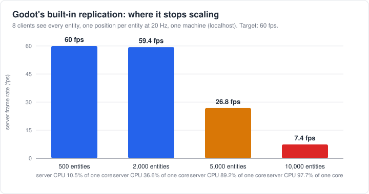
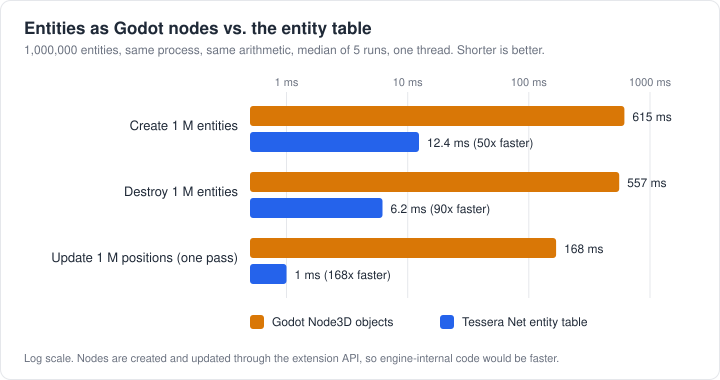
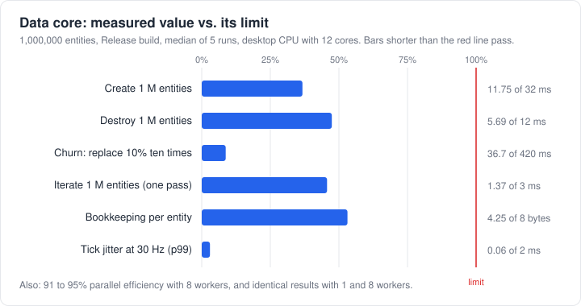

# Benchmarks

Numbers, how they were measured, and how to reproduce them. Every benchmark has its source in
[`bench/`](../bench/README.md). All results come from one desktop machine (AMD Ryzen 9 5900X, 12 cores,
64 GB RAM, Windows 11) that was also running other programs, so results vary from run to run. We report the
median, and the range where the variation is large.

## 1. Where Godot's built-in replication stops scaling

This is the measurement that motivates the project. Source: [`bench/godot-replication`](../bench/godot-replication/).



| Entities | Server fps (target 60) | Server CPU (1 core = 100%) | Bandwidth per client |
|---|---|---|---|
| 500 | 60 | 10.5% | 189 KB/s |
| 2,000 | 59.4 | 36.6% | 751 KB/s |
| 5,000 | 26.8 | 89.2% | 1.7 MB/s |
| 10,000 | 7.4 | 97.7% | 1.9 MB/s |

A headless Godot 4.7.2 server; each entity is a node with a `MultiplayerSynchronizer` replicating one
position at 20 Hz; 8 bot clients see every entity; everything runs over localhost. That works out to about
19 bytes per position update and about 0.85 million entity-client updates per second per core: the cost
grows with entities times clients, on a single thread.

Limits of this test: no network latency or packet loss, only positions, one run per scenario, no
visibility filtering. Treat it as an order of magnitude.

## 2. One million entities: Godot nodes versus the entity table

If every entity is a node, creating, updating and removing a million of them is expensive. The entity table
does the same job on plain arrays. Source: [`bench/godot-nodes`](../bench/godot-nodes/).



| Operation (1,000,000 entities) | Godot `Node3D` objects | Entity table | Ratio |
|---|---|---|---|
| Create | 615 ms | 12.4 ms | 50x |
| Destroy | 557 ms | 6.2 ms | 90x |
| Update every position once | 168 ms | 1.0 ms | 168x |

Three executions of the benchmark, each the median of 5 runs, gave 584 to 622 ms, 532 to 569 ms and
164 to 170 ms for the nodes, and 12.4 to 16.0 ms, 5.9 to 6.6 ms and 0.99 to 1.03 ms for the table.

How to read this fairly:
- The nodes are created, read and written from a GDExtension through the public API, without a scene tree.
  Code inside the engine (a C++ module) skips the API call overhead and would be faster; GDScript would be
  slower. The table runs in the same process with the same arithmetic.
- This compares how entities are **stored**, not how they are replicated. The core does not replicate yet, so
  there is no replication comparison to show; when there is, it will be added here.
- A node does more than a table slot does (transforms, signals, scene tree). That is exactly why it is
  heavy as the unit of a huge simulation, and also why it remains the right tool for what the player sees.

## 3. The entity table versus a general-purpose ECS

An entity-component-system library lets you add and remove components at any time. The entity table cannot,
and in return it is faster at the operations a replicated server repeats every tick. Source:
[`bench/ecs-comparison`](../bench/ecs-comparison/) (compares against EnTT 3.16).

| Operation (1,000,000 entities, one thread) | Entity table | EnTT |
|---|---|---|
| Create | 14.0 ms (11.5 to 20.7) | 102 ms (85 to 162) |
| Destroy | 13.7 ms (12.5 to 15.5) | 201 ms (191 to 253) |
| Churn: replace 10%, ten rounds | 80 ms (32 to 157) | 1,784 ms (1,446 to 2,876) |
| Update every position once | 1.6 ms (1.4 to 2.8) | 3.4 ms (2.9 to 5.2) |
| Write the 10% that changed (dirty flag) | 0.79 ms (0.73 to 1.19) | 5.2 ms (4.2 to 7.8) |
| Write the 10% that changed (tag component) | not needed | 19 ms (15 to 35) |

Median of five executions of the program, with the range in parentheses. The comparison favours the table
because it does less: it cannot add components to a live entity or answer arbitrary queries. It shows what
that generality costs for this use, not that EnTT is slow. EnTT groups and memory use were not measured.

One thing we have not explained: destroying a million entities takes about 6 ms in the data core benchmark
(section 4) but about 13 ms in this program, consistently. Both programs use the same table code, so compare
numbers only within one program.

## 4. The data core



| Criterion | Limit | Measured (median of 3 runs) |
|---|---|---|
| Create 1 M entities | 32 ms | 11.8 ms |
| Destroy 1 M entities (in creation order) | 12 ms | 5.7 ms |
| Destroy 1 M entities (random order) | no limit | about 10 to 11 ms |
| Churn: destroy and recreate 10%, ten times | 420 ms | 36.7 ms |
| Iterate 1 M entities, one pass | 3 ms | 1.4 ms |
| Bookkeeping per entity | 8 bytes | 4.25 bytes |
| Parallel efficiency, 8 workers | at least 70% | 91 to 95% |
| Tick jitter at 30 Hz, p99, no load | 2 ms | 0.06 ms |
| Same result with 1 and 8 workers, 1,000 ticks | identical | identical |

The limits were chosen before the final measurements, with a safety margin. They work as a regression
guard: the benchmark fails if the core becomes slower than its limit.

Conditions: 1,000,000 entities, Release build (MSVC), median of 5 runs inside each execution. The parallel
efficiency test is pure CPU work (about 100 ns per item), so real workloads that touch more memory will
scale less well. Only Windows has been measured so far; Linux results will be added.

## Reproduce

Windows, from the repository root (details and prerequisites for each benchmark are in
[`bench/README.md`](../bench/README.md)):

```powershell
# data core (section 4)
cmake --preset windows-msvc -DTESSERA_BUILD_BENCH=ON
cmake --build --preset windows-msvc-release --target tessera_net_bench
./build/windows-msvc/bench/Release/tessera_net_bench.exe

# entity table vs EnTT (section 3); downloads EnTT the first time
cmake --preset windows-msvc -DTESSERA_BUILD_ECS_COMPARISON=ON
cmake --build --preset windows-msvc-release --target tessera_net_ecs_comparison
./build/windows-msvc/bench/ecs-comparison/Release/tessera_net_ecs_comparison.exe
```

The charts are plain SVG files generated by `python tools/make_charts.py` (no dependencies). The numbers are
at the top of that script.
